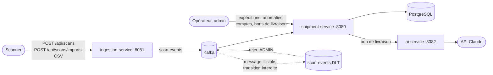

# Logistics Flow Platform

[](https://github.com/MPeyrot/logistics-flow-platform/actions/workflows/ci.yml)

Suivi de flux logistiques : des scanners envoient des événements (colis pris en charge, arrivé sur un site, en livraison, livré), la plateforme met à jour l'état des expéditions de façon asynchrone, détecte les retards et lit les bons de livraison avec l'API Claude.

**Projet personnel**, conçu et développé seul pour démontrer une stack Java d'entreprise : Spring Boot, Kafka, PostgreSQL, architecture hexagonale, tests d'intégration avec de vrais conteneurs. Ce n'est pas un logiciel en production.

## Architecture



| Dossier | Rôle |
| --- | --- |
| `services/ingestion-service` | Reçoit les scans en HTTP, un par un ou par import CSV (Spring Batch), les valide et les publie sur Kafka. Sans base de données. |
| `services/shipment-service` | Expéditions, comptes et jetons JWT. Consomme les scans, applique les transitions de statut, détecte les anomalies, rejoue les messages du DLT. Relaie les bons de livraison à `ai-service`. |
| `services/ai-service` | Extrait les données d'un bon de livraison (PDF ou image) avec l'API Claude : JSON validé, jetons et coût de chaque requête, budget quotidien. |
| `contracts/` | Schémas JSON versionnés des messages Kafka. Pas de bibliothèque partagée entre services : le contrat fait foi. |
| `scripts/deploy/` | Mise en place de Google Cloud et parcours de fumée du déploiement. |

Chaque service suit l'architecture hexagonale (`domain` / `application` / `infrastructure`), vérifiée par des tests ArchUnit. Les choix de conception et leurs raisons sont notés dans [`.claude/rules/architecture.md`](.claude/rules/architecture.md).

### Points techniques

- **Ordre et fiabilité des scans** : clé Kafka = référence d'expédition (ordre garanti par expédition) ; consommateur idempotent (clé primaire sur l'identifiant d'événement) ; nouvelles tentatives avec backoff exponentiel quand le scan arrive avant l'expédition ; topic d'erreurs `scan-events.DLT`, lisible et rejouable par un ADMIN (rejeu par outbox transactionnelle, au moins une fois).
- **Anomalies** : tâche planifiée qui ouvre une anomalie LATE (non livrée à la date prévue) ou STALLED (aucun scan depuis 48 h), une seule ouverte par expédition et type même avec plusieurs instances, refermée au scan ou à la livraison suivante.
- **Authentification** : JWT RS256 émis par `shipment-service`, clé publique sur `/.well-known/jwks.json`, validés par les deux autres services sans secret partagé. Rôles ADMIN, OPERATOR, SCANNER (rattaché à un site).
- **Import CSV** : synchrone, lignes invalides sautées et rapportées, identifiant d'événement déterministe (réimporter un fichier ne crée pas de doublon).
- **Appels à Claude** : réponse du modèle traitée comme une donnée externe (Bean Validation), coût calculé par requête, quotas horaires et budget quotidien en dollars.

## Stack

Java 21, Spring Boot 4.1, Spring Security (JWT), Spring Data JPA / Hibernate, Flyway, PostgreSQL 17, Apache Kafka, Spring Batch, SDK Java Anthropic, Maven, JUnit 5, Testcontainers, WireMock, ArchUnit, Docker Compose, GitHub Actions, Google Cloud Run.

## Statuts d'une expédition

| Statut | Scan | Nouveau statut |
| --- | --- | --- |
| CREATED | PICKED_UP | IN_TRANSIT |
| IN_TRANSIT | ARRIVED_AT_SITE | IN_TRANSIT |
| IN_TRANSIT | OUT_FOR_DELIVERY | OUT_FOR_DELIVERY |
| OUT_FOR_DELIVERY | DELIVERED | DELIVERED |
| OUT_FOR_DELIVERY | DELIVERY_FAILED | DELIVERY_FAILED |
| DELIVERY_FAILED | ARRIVED_AT_SITE | IN_TRANSIT |

DELIVERED est terminal ; tout autre scan est refusé et part dans `scan-events.DLT`. Le contrat `contracts/scan-event.v2.schema.json` porte les cinq types de scan et un motif facultatif `reason` (DELIVERY_FAILED seulement) ; un message `scan-event.v1` reste lisible.

## Lancer en local

Prérequis : JDK 21, Docker ; `curl` et `jq` pour le parcours ci-dessous.

```sh
scripts/generate-jwt-key.sh    # une fois : clé de signature des JWT dans .secrets/ (ignoré par git)
source scripts/env.sh          # JAVA_HOME sur openjdk@21 (macOS/Homebrew ; adapter ailleurs) et JWT_PRIVATE_KEY
docker compose up -d --wait    # PostgreSQL et Kafka

# premier ADMIN, créé au démarrage s'il n'en existe aucun (mot de passe : 12 caractères au moins)
(cd services/shipment-service && BOOTSTRAP_ADMIN_USERNAME=admin BOOTSTRAP_ADMIN_PASSWORD=... ./mvnw spring-boot:run) &
(cd services/ingestion-service && ./mvnw spring-boot:run) &
(cd services/ai-service && ANTHROPIC_API_KEY=... ./mvnw spring-boot:run) &   # clé d'API Claude, facultative
```

Sans `ANTHROPIC_API_KEY`, `ai-service` démarre et répond 503 aux extractions.

| Variable | Service | Rôle |
|---|---|---|
| `JWT_PRIVATE_KEY` | shipment-service | clé privée RSA (PEM) qui signe les jetons ; obligatoire, chargée par `scripts/env.sh` |
| `BOOTSTRAP_ADMIN_USERNAME`, `BOOTSTRAP_ADMIN_PASSWORD` | shipment-service | premier ADMIN, créé au démarrage s'il n'en existe aucun |
| `SHIPMENT_SERVICE_URL` | ingestion-service, ai-service | où lire la clé publique des JWT ; défaut `http://localhost:8080` |
| `AI_SERVICE_URL` | shipment-service | où joindre ai-service ; défaut `http://localhost:8082` |
| `ANTHROPIC_API_KEY`, `AI_CLAUDE_MODEL`, `AI_DAILY_BUDGET_USD` | ai-service | clé de l'API Claude, modèle (défaut `claude-haiku-5-5`), budget quotidien (défaut 1 $) |

### Parcours complet

```sh
# 1. jeton ADMIN (valable 1 h)
ADMIN=$(curl -s -X POST localhost:8080/api/auth/token -H 'Content-Type: application/json' \
  -d '{"username":"admin","password":"..."}' | jq -r .accessToken)

# 2. un compte SCANNER (rattaché à un site) et un compte OPERATOR
curl -X POST localhost:8080/api/users -H "Authorization: Bearer $ADMIN" -H 'Content-Type: application/json' \
  -d '{"username":"scanner-nantes","password":"un mot de passe long","role":"SCANNER","site":"Nantes"}'
curl -X POST localhost:8080/api/users -H "Authorization: Bearer $ADMIN" -H 'Content-Type: application/json' \
  -d '{"username":"operateur","password":"un mot de passe long","role":"OPERATOR"}'

# 3. leurs jetons (SCANNER : 12 h, OPERATOR : 1 h)
SCANNER=$(curl -s -X POST localhost:8080/api/auth/token -H 'Content-Type: application/json' \
  -d '{"username":"scanner-nantes","password":"un mot de passe long"}' | jq -r .accessToken)
OPERATOR=$(curl -s -X POST localhost:8080/api/auth/token -H 'Content-Type: application/json' \
  -d '{"username":"operateur","password":"un mot de passe long"}' | jq -r .accessToken)

# 4. créer une expédition (OPERATOR), livraison prévue dans trois jours
#    (macOS ; sous Linux : date -u -d '+3 days' +%Y-%m-%dT%H:%M:%SZ)
DUE=$(date -u -v+3d +%Y-%m-%dT%H:%M:%SZ)
curl -X POST localhost:8080/api/shipments -H "Authorization: Bearer $OPERATOR" -H 'Content-Type: application/json' \
  -d '{"reference":"REF-1001","origin":"Nantes","destination":"Lyon","expectedDeliveryAt":"'"$DUE"'"}'

# 5. scanner (SCANNER, depuis le site de son compte ; traité en asynchrone via Kafka)
curl -X POST localhost:8081/api/scans -H "Authorization: Bearer $SCANNER" -H 'Content-Type: application/json' \
  -d '{"shipmentReference":"REF-1001","type":"PICKED_UP","site":"Nantes"}'

# 6. le statut est passé de CREATED à IN_TRANSIT
curl -H "Authorization: Bearer $OPERATOR" localhost:8080/api/shipments

#    suite : OUT_FOR_DELIVERY, puis DELIVERED, ou DELIVERY_FAILED avec un motif facultatif (1 à 200 caractères)
curl -X POST localhost:8081/api/scans -H "Authorization: Bearer $SCANNER" -H 'Content-Type: application/json' \
  -d '{"shipmentReference":"REF-1001","type":"OUT_FOR_DELIVERY","site":"Nantes"}'
curl -X POST localhost:8081/api/scans -H "Authorization: Bearer $SCANNER" -H 'Content-Type: application/json' \
  -d '{"shipmentReference":"REF-1001","type":"DELIVERY_FAILED","site":"Nantes","reason":"Destinataire absent"}'

# 7. importer un fichier CSV de scans (SCANNER)
curl -H "Authorization: Bearer $SCANNER" -F file=@scans.csv localhost:8081/api/scans/imports

# 8. anomalies ouvertes (open=false : closes ; sans paramètre : toutes)
curl -H "Authorization: Bearer $OPERATOR" 'localhost:8080/api/anomalies?open=true'

# 9. lire un bon de livraison (PDF ou image) : données extraites, coût, expédition correspondante.
#    Chaque appel est facturé par l'API Claude : 20 par heure et par utilisateur.
curl -H "Authorization: Bearer $OPERATOR" -F file=@bon.pdf localhost:8080/api/delivery-notes/extract

# 10. messages en erreur (ADMIN) : lister, puis tout rejouer
curl -H "Authorization: Bearer $ADMIN" localhost:8080/api/admin/dlt/scan-events
curl -X POST -H "Authorization: Bearer $ADMIN" localhost:8080/api/admin/dlt/scan-events/replay
```

### Routes et rôles

Sans jeton : 401 ; rôle non permis : 403. Les erreurs sont en `application/problem+json`.

| Route | ADMIN | OPERATOR | SCANNER |
| --- | --- | --- | --- |
| `POST /api/auth/token` | sans jeton | sans jeton | sans jeton |
| `GET`, `POST /api/shipments` | oui | oui | non |
| `GET /api/anomalies` | oui | oui | non |
| `POST /api/delivery-notes/extract` | oui | oui | non |
| `POST /api/users`, `PATCH /api/users/{id}` | oui | non | non |
| `/api/admin/dlt/scan-events` (liste, rejeu d'un message ou de tous) | oui | non | non |
| `POST /api/scans`, `POST /api/scans/imports` (ingestion-service) | non | non | oui, site du compte |

### Import CSV

`POST /api/scans/imports` (`multipart/form-data`, partie `file`) attend un CSV UTF-8 avec en-tête : `shipmentReference`, `type`, `site`, `occurredAt` (ISO-8601), et facultativement `eventId` et `reason`, dans n'importe quel ordre. Guillemets RFC 4180 acceptés.

```csv
shipmentReference,type,site,occurredAt
REF-1001,ARRIVED_AT_SITE,Nantes,2026-11-07T08:30:00Z
REF-1002,PICKED_UP,Nantes,2026-11-07T09:00:00Z
```

- Réponse 200, même si des lignes sont rejetées : `{"lines","published","rejected","errors":[{"line","detail"}]}`.
- Plafonds : 2 Mo (413) et 10 000 lignes (400), contrôlés avant toute publication.
- Un seul import à la fois par instance : le suivant attend jusqu'à 30 s, puis 429 avec `Retry-After`. Kafka en panne : 503 avec le nombre de lignes déjà publiées ; réimporter le fichier ne crée pas de doublon.

### Contre Confluent Cloud

Avec le profil Spring `confluent`, `shipment-service` et `ingestion-service` se connectent à un cluster Confluent Cloud (SASL_SSL, PLAIN, topics à 3 répliques) au lieu du Kafka local. Une clé d'API par service :

```sh
mkdir -p .secrets    # ignoré par git
cat > .secrets/confluent.env <<'ENV'
CONFLUENT_BOOTSTRAP_SERVERS=pkc-xxxxx.region.provider.confluent.cloud:9092
SHIPMENT_KAFKA_API_KEY=...
SHIPMENT_KAFKA_API_SECRET=...
INGESTION_KAFKA_API_KEY=...
INGESTION_KAFKA_API_SECRET=...
ENV
chmod 600 .secrets/confluent.env

docker compose up -d shipments-db --wait   # PostgreSQL seul, pas le Kafka local
source scripts/env.sh
set -a; source .secrets/confluent.env; set +a
export SPRING_PROFILES_ACTIVE=confluent KAFKA_BOOTSTRAP_SERVERS="$CONFLUENT_BOOTSTRAP_SERVERS"

(cd services/shipment-service && KAFKA_API_KEY="$SHIPMENT_KAFKA_API_KEY" \
  KAFKA_API_SECRET="$SHIPMENT_KAFKA_API_SECRET" ./mvnw spring-boot:run) &
(cd services/ingestion-service && KAFKA_API_KEY="$INGESTION_KAFKA_API_KEY" \
  KAFKA_API_SECRET="$INGESTION_KAFKA_API_SECRET" ./mvnw spring-boot:run) &
```

- Adresse : le « Bootstrap server » du cluster (`pkc-….confluent.cloud:9092`), pas l'endpoint REST (sinon la connexion est coupée pendant l'authentification, en boucle).
- Droits : ingestion-service écrit sur `scan-events` ; shipment-service lit `scan-events` (groupe `shipment-service`), lit et écrit `scan-events.DLT`, et écrit sur `scan-events` pour les rejeux. Sans droit de création de topics, créer `scan-events` et `scan-events.DLT` (3 partitions) à la main.

## Déployer

Démo à la demande sur Google Cloud Run (`europe-west1`), base Neon, Kafka sur Confluent Cloud, profils `confluent,gcp` (journaux JSON pour Cloud Logging).

**Mise en place**, une seule fois : `scripts/deploy/setup-wizard.sh`. L'assistant guide ce qui demande un compte ou une valeur secrète (projet GCP et facturation, alerte de budget, base Neon, clés JWT, Confluent et Claude, variables du dépôt GitHub), puis lance `scripts/deploy/infra.sh`, qui crée les ressources de façon idempotente :

- Artifact Registry `logistics` (les 2 dernières images par service) ;
- secrets dans Secret Manager, lus masqués au clavier, jamais écrits sur disque ;
- un compte d'exécution par service (front compris, `frontend-run`, sans aucun secret), avec accès à ses seuls secrets ;
- un compte de déploiement joint par Workload Identity Federation, limité à la branche `main` de ce dépôt : GitHub Actions s'authentifie sans clé JSON ;
- une métrique basée sur les journaux pour le coût des appels à Claude.

**Up et down**, deux workflows GitHub Actions lancés à la main :

- **Deploy up** (`deploy-up.yml`) : refuse un commit hors de `main` ou dont la CI n'est pas verte, construit les images (`spring-boot:build-image` pour les services, `frontend/Dockerfile` pour le front), déploie `shipment-service`, puis les deux autres, puis `frontend`, attend qu'ils répondent et lance un parcours de fumée (`scripts/deploy/smoke.sh`, sans appel à Claude, y compris à travers le front). **L'URL de la démo** est celle du front, affichée dans le résumé du workflow ; les services ne s'ouvrent pas directement dans le navigateur.
- **Deploy down** (`deploy-down.yml`) : supprime les quatre services Cloud Run (front compris) ; secrets, images, base et Kafka restent.

Coûts : ~0 $ démo arrêtée (offres gratuites de Neon, Confluent Basic et Artifact Registry ; quelques centimes de Secret Manager). Démo en marche, `shipment-service` reste actif (détection des anomalies, consommateur Kafka) : quelques dollars par jour. Lancer **down** une fois la démo finie.

**Comptes de la démo** : la base ne contient que l'ADMIN d'amorçage (identifiant `BOOTSTRAP_ADMIN_USERNAME`, mot de passe `BOOTSTRAP_ADMIN_PASSWORD`). Se connecter avec lui sur l'URL de la démo, puis créer les comptes OPERATOR et SCANNER (un SCANNER est rattaché à un site) depuis l'écran des comptes.

## Front

Angular (zoneless, Material) dans `frontend/`. Node : version de `frontend/.nvmrc` (24, LTS ; la CLI Angular exige au moins 24.15).

```sh
cd frontend
npm ci
npm start          # http://localhost:4200, /api/scans et /api/scans/… -> :8081, /api et /.well-known -> :8080 (proxy.conf.json)
npm run lint
npm test           # Vitest, une passe
npm run build
npx playwright install chromium   # une fois par machine
npm run e2e        # Playwright, ng serve sur E2E_PORT (4200 par défaut), API simulée
```

Lancer d'abord les services (voir « Lancer en local ») pour que le proxy ait quelqu'un à qui parler.

## Tests

```sh
source scripts/env.sh
cd services/shipment-service && ./mvnw verify
cd services/ingestion-service && ./mvnw verify
cd services/ai-service && ./mvnw verify    # API Claude simulée par WireMock, aucune clé nécessaire
```

Les tests d'intégration démarrent PostgreSQL et Kafka avec Testcontainers : Docker doit tourner. Aucun test n'appelle la vraie API Claude.

## État du projet

Fait : expéditions et cycle de vie complet, comptes et JWT, ingestion des scans (HTTP et import CSV), consommation Kafka idempotente avec DLT et rejeu, détection des retards, lecture des bons de livraison avec Claude, CI et déploiement à la demande sur Cloud Run.

À venir : interface web en Angular.
