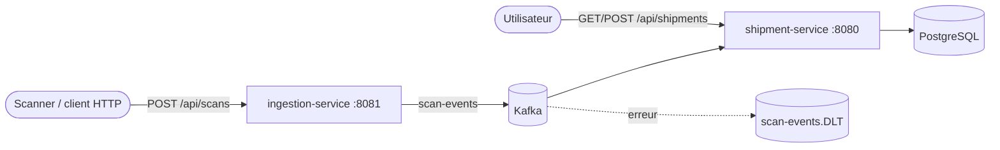

# Logistics Flow Platform

[](https://github.com/MPeyrot/logistics-flow-platform/actions/workflows/ci.yml)

Suivi de flux logistiques : des scanners envoient des événements (colis pris en charge, arrivé sur un site, livré), la plateforme met à jour l'état des expéditions de façon asynchrone.

Projet personnel pour s'exercer à une stack Java d'entreprise : Spring Boot, Kafka, PostgreSQL, architecture hexagonale, tests d'intégration avec de vrais conteneurs.

## Architecture



| Dossier | Rôle |
| --- | --- |
| `services/ingestion-service` | Reçoit les scans en HTTP, les valide, les publie sur Kafka (accusé du broker attendu avant le `202`). |
| `services/shipment-service` | API des expéditions. Consomme les scans, applique les transitions de statut, garde l'historique. |
| `contracts/` | Schéma JSON versionné des messages Kafka. Pas de bibliothèque partagée entre services. |

Chaque service suit l'architecture hexagonale (`domain` / `application` / `infrastructure`), vérifiée par des tests ArchUnit. Le détail des choix est dans [`.claude/rules/architecture.md`](.claude/rules/architecture.md).

Points de fiabilité côté consommateur : traitement idempotent (clé primaire sur l'identifiant d'événement), nouvelles tentatives sur les erreurs transitoires, topic d'erreurs `scan-events.DLT` pour les messages illisibles ou les transitions interdites.

## Stack

Java 21, Spring Boot 4.1, Spring Data JPA / Hibernate, Flyway, PostgreSQL 17, Apache Kafka, Maven, JUnit 5, Testcontainers, ArchUnit, Docker Compose, GitHub Actions.

## Lancer en local

Prérequis : JDK 21, Docker.

```sh
source scripts/env.sh          # JAVA_HOME sur openjdk@21 (macOS/Homebrew ; adapter ailleurs)
docker compose up -d --wait    # PostgreSQL et Kafka

(cd services/shipment-service && ./mvnw spring-boot:run) &
(cd services/ingestion-service && ./mvnw spring-boot:run) &
```

Exemple :

```sh
# 1. créer une expédition
curl -X POST localhost:8080/api/shipments -H 'Content-Type: application/json' \
  -d '{"reference":"REF-1001","origin":"Nantes","destination":"Lyon"}'

# 2. envoyer un scan (traité en asynchrone via Kafka)
curl -X POST localhost:8081/api/scans -H 'Content-Type: application/json' \
  -d '{"shipmentReference":"REF-1001","type":"PICKED_UP","site":"Nantes"}'

# 3. le statut est passé de CREATED à IN_TRANSIT
curl localhost:8080/api/shipments
```

## Tests

```sh
cd services/shipment-service && ./mvnw verify
cd services/ingestion-service && ./mvnw verify
```

Les tests d'intégration démarrent PostgreSQL et Kafka avec Testcontainers : Docker doit tourner.

## État du projet

Fait : création et liste des expéditions, ingestion des scans, consommation Kafka idempotente avec topic d'erreurs, CI.

À venir : import par lot (Spring Batch), `ai-service` (extraction de bons de livraison avec l'API Claude), front Vue 3 + TypeScript, authentification JWT, déploiement sur GCP Cloud Run.

Les statuts d'expédition et les types de scan sont provisoires.
