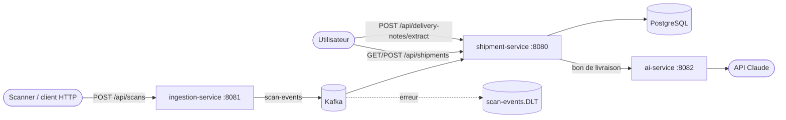

# Logistics Flow Platform

[](https://github.com/MPeyrot/logistics-flow-platform/actions/workflows/ci.yml)

Suivi de flux logistiques : des scanners envoient des événements (colis pris en charge, arrivé sur un site, livré), la plateforme met à jour l'état des expéditions de façon asynchrone.

Projet personnel pour s'exercer à une stack Java d'entreprise : Spring Boot, Kafka, PostgreSQL, architecture hexagonale, tests d'intégration avec de vrais conteneurs.

## Architecture



| Dossier | Rôle |
| --- | --- |
| `services/ingestion-service` | Reçoit les scans en HTTP, les valide, les publie sur Kafka (accusé du broker attendu avant le `202`). Import CSV synchrone (`POST /api/scans/imports`, voir ci-dessous). |
| `services/shipment-service` | API des expéditions. Consomme les scans, applique les transitions de statut, garde l'historique. Relaie les bons de livraison à `ai-service` et retrouve l'expédition correspondante. |
| `services/ai-service` | Extrait les données d'un bon de livraison (PDF ou image) avec l'API Claude : JSON validé, jetons et coût de chaque requête. |
| `contracts/` | Schéma JSON versionné des messages Kafka. Pas de bibliothèque partagée entre services. |

Chaque service suit l'architecture hexagonale (`domain` / `application` / `infrastructure`), vérifiée par des tests ArchUnit. Le détail des choix est dans [`.claude/rules/architecture.md`](.claude/rules/architecture.md).

Points de fiabilité côté consommateur : traitement idempotent (clé primaire sur l'identifiant d'événement), nouvelles tentatives sur les erreurs transitoires, topic d'erreurs `scan-events.DLT` pour les messages illisibles ou les transitions interdites.

## Stack

Java 21, Spring Boot 4.1, Spring Security (JWT), Spring Data JPA / Hibernate, Flyway, PostgreSQL 17, Apache Kafka, Maven, JUnit 5, Testcontainers, ArchUnit, Docker Compose, GitHub Actions.

## Lancer en local

Prérequis : JDK 21, Docker ; `curl` et `jq` pour le parcours ci-dessous.

```sh
scripts/generate-jwt-key.sh    # une fois : clé de signature des JWT dans .secrets/ (ignoré par git)
source scripts/env.sh          # JAVA_HOME sur openjdk@21 (macOS/Homebrew ; adapter ailleurs) et JWT_PRIVATE_KEY
docker compose up -d --wait    # PostgreSQL et Kafka

# premier ADMIN, créé au démarrage s'il n'en existe aucun (mot de passe : 12 caractères au moins)
(cd services/shipment-service && BOOTSTRAP_ADMIN_USERNAME=admin BOOTSTRAP_ADMIN_PASSWORD=... ./mvnw spring-boot:run) &
(cd services/ingestion-service && ./mvnw spring-boot:run) &
(cd services/ai-service && ANTHROPIC_API_KEY=... ./mvnw spring-boot:run) &   # clé d'API Claude, jamais dans le dépôt
```

Variables d'environnement liées à l'authentification :

| Variable | Service | Rôle |
|---|---|---|
| `JWT_PRIVATE_KEY` | shipment-service | clé privée RSA (PEM) qui signe les jetons ; obligatoire. `scripts/env.sh` la charge depuis `.secrets/` |
| `BOOTSTRAP_ADMIN_USERNAME`, `BOOTSTRAP_ADMIN_PASSWORD` | shipment-service | premier ADMIN, créé au démarrage s'il n'en existe aucun |
| `SHIPMENT_SERVICE_URL` | ingestion-service, ai-service | où lire la clé publique (`/.well-known/jwks.json`) ; défaut `http://localhost:8080` |
| `AI_SERVICE_URL` | shipment-service | où joindre ai-service ; défaut `http://localhost:8082` |

Parcours complet (les rôles et les jetons sont décrits dans `.claude/rules/architecture.md`) :

```sh
# 1. jeton ADMIN (valable 1 h)
ADMIN=$(curl -s -X POST localhost:8080/api/auth/token -H 'Content-Type: application/json' \
  -d '{"username":"admin","password":"..."}' | jq -r .accessToken)

# 2. créer un compte SCANNER (rattaché à un site) et un compte OPERATOR
curl -X POST localhost:8080/api/users -H "Authorization: Bearer $ADMIN" -H 'Content-Type: application/json' \
  -d '{"username":"scanner-nantes","password":"un mot de passe long","role":"SCANNER","site":"Nantes"}'
curl -X POST localhost:8080/api/users -H "Authorization: Bearer $ADMIN" -H 'Content-Type: application/json' \
  -d '{"username":"operateur","password":"un mot de passe long","role":"OPERATOR"}'

# 3. jeton SCANNER (valable 12 h) et jeton OPERATOR (1 h)
SCANNER=$(curl -s -X POST localhost:8080/api/auth/token -H 'Content-Type: application/json' \
  -d '{"username":"scanner-nantes","password":"un mot de passe long"}' | jq -r .accessToken)
OPERATOR=$(curl -s -X POST localhost:8080/api/auth/token -H 'Content-Type: application/json' \
  -d '{"username":"operateur","password":"un mot de passe long"}' | jq -r .accessToken)

# 4. créer une expédition (OPERATOR). expectedDeliveryAt (ISO-8601) est obligatoire et dans le futur, sinon 400.
#    Ici dans trois jours (macOS ; sous Linux : date -u -d '+3 days' +%Y-%m-%dT%H:%M:%SZ).
DUE=$(date -u -v+3d +%Y-%m-%dT%H:%M:%SZ)
curl -X POST localhost:8080/api/shipments -H "Authorization: Bearer $OPERATOR" -H 'Content-Type: application/json' \
  -d '{"reference":"REF-1001","origin":"Nantes","destination":"Lyon","expectedDeliveryAt":"'"$DUE"'"}'

# 5. envoyer un scan (SCANNER ; le site doit être celui du compte ; traité en asynchrone via Kafka,
#    message au format contracts/scan-event.v2.schema.json)
curl -X POST localhost:8081/api/scans -H "Authorization: Bearer $SCANNER" -H 'Content-Type: application/json' \
  -d '{"shipmentReference":"REF-1001","type":"PICKED_UP","site":"Nantes"}'

# 6. le statut est passé de CREATED à IN_TRANSIT
curl -H "Authorization: Bearer $OPERATOR" localhost:8080/api/shipments

#    suite du parcours : OUT_FOR_DELIVERY, puis DELIVERED, ou DELIVERY_FAILED avec un motif facultatif
#    (reason, 1 à 200 caractères, seulement avec DELIVERY_FAILED, sinon 400). Le compte SCANNER de
#    l'exemple est rattaché à Nantes : il scanne donc tout depuis Nantes.
curl -X POST localhost:8081/api/scans -H "Authorization: Bearer $SCANNER" -H 'Content-Type: application/json' \
  -d '{"shipmentReference":"REF-1001","type":"OUT_FOR_DELIVERY","site":"Nantes"}'
curl -X POST localhost:8081/api/scans -H "Authorization: Bearer $SCANNER" -H 'Content-Type: application/json' \
  -d '{"shipmentReference":"REF-1001","type":"DELIVERY_FAILED","site":"Nantes","reason":"Destinataire absent"}'

# 7. lire un bon de livraison (PDF ou image) : données extraites, coût, expédition correspondante.
#    Chaque appel coûte un appel à l'API Claude : 20 par heure et par utilisateur (429 avec Retry-After au-delà).
curl -H "Authorization: Bearer $OPERATOR" -F file=@bon.pdf localhost:8080/api/delivery-notes/extract

# 8. anomalies (ADMIN, OPERATOR) : open=true (ouvertes), open=false (closes), sans paramètre (toutes),
#    les plus récemment détectées d'abord ; open invalide : 400.
curl -H "Authorization: Bearer $OPERATOR" 'localhost:8080/api/anomalies?open=true'
#    les anomalies ouvertes d'une expédition sont aussi dans openAnomalies de GET /api/shipments

# 9. importer un fichier CSV de scans (SCANNER seulement, chaque ligne du site du compte)
curl -H "Authorization: Bearer $SCANNER" -F file=@scans.csv localhost:8081/api/scans/imports
```

#### Import CSV (ingestion-service)

`POST /api/scans/imports`, `multipart/form-data`, partie `file`, synchrone : la réponse arrive quand tout est publié. SCANNER seulement (sans jeton : 401 ; OPERATOR, ADMIN : 403), et chaque ligne doit être du site du jeton.

- CSV UTF-8 (BOM, CRLF acceptés), guillemets RFC 4180 (un champ entre guillemets peut contenir une virgule, un guillemet doublé ou un saut de ligne ; le plafond et les numéros de ligne des erreurs comptent des enregistrements, la ligne d'une erreur étant la première de l'enregistrement ; un guillemet jamais fermé : 400), une ligne commençant par `#` est une ligne comme une autre, les espaces autour d'une cellule hors guillemets sont rognés (ceux d'une cellule entre guillemets sont gardés), en-tête obligatoire, colonnes dans n'importe quel ordre : `shipmentReference`, `type`, `site`, `occurredAt` (obligatoires), `eventId` et `reason` (facultatives). Même validation que `POST /api/scans`.
- Réponse 200, même si toutes les lignes sont rejetées : `{"lines","published","rejected","errors":[{"line","detail"}]}` (`line` : numéro de ligne du fichier, en-tête = 1 ; 100 erreurs détaillées au plus, `rejected` est le total exact).
- Sans `eventId` dans la ligne, il est déterministe (UUID calculé sur `shipmentReference|type|site|occurredAt`) : réimporter le même fichier ne crée pas de doublon côté `shipment-service`.
- 400 `problem+json` et rien de publié : partie `file` absente, erreur de structure (fichier vide, en-tête, colonne inconnue ou manquante, encodage), plus de 10 000 lignes de données. 413 : fichier de plus de 2 Mo. 503 avec `published` : Kafka en panne en cours d'import (réimporter le fichier). 429 + `Retry-After` : un autre import tourne depuis plus de 30 s.
- Réglages : `ingestion.import.max-lines` (10 000), `ingestion.import.wait` (30 s, attente d'un import en cours), `spring.servlet.multipart.max-file-size` et `max-request-size` (2 MB). Un seul import à la fois par instance.
- Journal : une ligne `scan import finished` par import lancé (`outcome` = `completed`, `interrupted` pour une publication en panne ou `failed` ; INFO si réussi, WARN sinon ; `lines`, `published`, `rejected`, `site`, `durationMs`), jamais le contenu des lignes. Un import refusé avant de tourner (structure, 429) n'en écrit pas.

Accès aux routes de `shipment-service` (sans jeton : 401 ; rôle non permis : 403) :

| Route | ADMIN | OPERATOR | SCANNER |
| --- | --- | --- | --- |
| `GET /api/shipments`, `POST /api/shipments` | oui | oui | 403 |
| `GET /api/anomalies` | oui | oui | 403 |
| `POST /api/delivery-notes/extract` | oui | oui | 403 |
| `POST /api/users`, `PATCH /api/users/{id}` | oui | 403 | 403 |

### Contre Confluent Cloud

Les deux services peuvent se connecter à un cluster Confluent Cloud au lieu du Kafka local, avec le profil Spring `confluent` (SASL_SSL, mécanisme PLAIN, topics à 3 répliques). Sans le profil, rien ne change.

Une clé d'API par service, pour que chacun n'ait que ses droits :

```sh
mkdir -p .secrets    # ignoré par git
cat > .secrets/confluent.env <<'ENV'
CONFLUENT_BOOTSTRAP_SERVERS=pkc-xxxxx.region.provider.confluent.cloud:9092
SHIPMENT_KAFKA_API_KEY=...
SHIPMENT_KAFKA_API_SECRET=...
INGESTION_KAFKA_API_KEY=...
INGESTION_KAFKA_API_SECRET=...
ENV
chmod 600 .secrets/confluent.env

docker compose up -d shipments-db --wait   # PostgreSQL seul, pas le Kafka local
source scripts/env.sh                      # JAVA_HOME et JWT_PRIVATE_KEY
set -a; source .secrets/confluent.env; set +a
export SPRING_PROFILES_ACTIVE=confluent KAFKA_BOOTSTRAP_SERVERS="$CONFLUENT_BOOTSTRAP_SERVERS"

# chaque service reçoit sa propre clé, sous les noms que lit le profil
(cd services/shipment-service && KAFKA_API_KEY="$SHIPMENT_KAFKA_API_KEY" \
  KAFKA_API_SECRET="$SHIPMENT_KAFKA_API_SECRET" ./mvnw spring-boot:run) &
(cd services/ingestion-service && KAFKA_API_KEY="$INGESTION_KAFKA_API_KEY" \
  KAFKA_API_SECRET="$INGESTION_KAFKA_API_SECRET" ./mvnw spring-boot:run) &
```

**Adresse du cluster** : prendre le « Bootstrap server » des réglages du cluster (`pkc-….confluent.cloud:9092`), pas l'endpoint REST (`https://pkc-….confluent.cloud:443`). Avec l'endpoint REST, la connexion est coupée pendant l'authentification (« terminated during authentication ») et le service tente de se reconnecter sans fin.

Le démarrage est refusé si `KAFKA_API_KEY` ou `KAFKA_API_SECRET` manque. Le nombre de répliques se règle avec `KAFKA_TOPICS_REPLICAS` (1 par défaut, 3 avec le profil).

Droits des clés d'API : ingestion-service écrit sur `scan-events` ; shipment-service lit `scan-events` (groupe de consommateurs `shipment-service`), lit et écrit `scan-events.DLT`, et republie sur `scan-events` lors d'un rejeu du DLT. Chaque service déclare ses topics au démarrage (3 partitions chacun) : sans le droit de créer des topics, les créer à la main dans l'interface Confluent avant de lancer les services.

## Déployer

Démo à la demande sur Google Cloud Run (`europe-west1`), base Neon, Kafka sur Confluent Cloud. Projet personnel : ce n'est pas un environnement de production.

Sur Cloud Run, les services tournent avec `SPRING_PROFILES_ACTIVE=confluent,gcp` : le profil `gcp` écrit les journaux en JSON structuré pour Cloud Logging (`severity`, `message`). Sans lui, journaux texte.

### Mise en place

Une seule fois, avant le premier déploiement :

```sh
scripts/deploy/setup-wizard.sh
```

L'assistant guide pas à pas ce qui demande un compte ou une valeur secrète, puis lance le reste. Relançable : une étape déjà faite se garde (il demande avant de remplacer un secret).

1. `gcloud` en local : il refuse le Python 3.9 de macOS ; l'assistant installe `python@3.13` (Homebrew) si besoin et le désigne par `CLOUDSDK_PYTHON`. Connexions `gcloud` et `gh`.
2. Projet GCP, rattachement à un compte de facturation, alerte de budget à 20 $ par mois.
3. `scripts/deploy/infra.sh` (ressources ci-dessous).
4. Base Neon : PostgreSQL 17, région AWS Europe Central 1 (Frankfurt), chaîne de connexion **directe** (pas le pooler : Flyway et ses verrous), `sslmode=require`. L'assistant la découpe en `DB_URL` (JDBC), `DB_USER`, `DB_PASSWORD`.
5. Clé JWT neuve (`scripts/generate-jwt-key.sh --stdout`), distincte de la clé locale ; mot de passe du premier ADMIN ; clés d'API Confluent (une par service, reprises de `.secrets/confluent.env` si elles y sont) ; clé de l'API Claude et plafond de dépense dans la Console Anthropic.
6. Variables du dépôt GitHub, lues par les workflows.

Les valeurs secrètes sont lues masquées au clavier et passées à `gcloud secrets versions add` par l'entrée standard : jamais affichées, jamais écrites dans un fichier. Les valeurs non secrètes (projet, adresse Kafka, identifiant de l'ADMIN) sont gardées dans `.secrets/deploy.env` (ignoré par git) pour une relance.

`infra.sh` se lance aussi seul : `PROJECT_ID=<projet> scripts/deploy/infra.sh` (`REGION` facultatif, `europe-west1` par défaut). Il crée ce qui manque, ne supprime rien et ne pose aucune valeur de secret. Noms des ressources : `scripts/deploy/names.sh`.

| Ressource | Nom et droits |
|---|---|
| API | Cloud Run, Artifact Registry, Secret Manager, IAM, IAM Credentials, STS, Resource Manager, Logging, Monitoring |
| Artifact Registry | dépôt Docker `logistics` ; règle de nettoyage : les 2 dernières images par service |
| Comptes d'exécution | `shipment-service-run`, `ingestion-service-run`, `ai-service-run` : `logging.logWriter`, `secretmanager.secretAccessor` sur leurs seuls secrets |
| Secrets (sans valeur) | shipment-service : `JWT_PRIVATE_KEY`, `BOOTSTRAP_ADMIN_PASSWORD`, `DB_URL`, `DB_USER`, `DB_PASSWORD`, `SHIPMENT_KAFKA_API_KEY`, `SHIPMENT_KAFKA_API_SECRET` ; ingestion-service : `INGESTION_KAFKA_API_KEY`, `INGESTION_KAFKA_API_SECRET` ; ai-service : `ANTHROPIC_API_KEY` |
| Compte de déploiement | `github-deployer` : `run.admin`, `artifactregistry.writer` sur `logistics`, `iam.serviceAccountUser` sur les trois comptes d'exécution |
| Workload Identity Federation | pool `github`, fournisseur `github-oidc` (GitHub OIDC), limité au dépôt `MPeyrot/logistics-flow-platform` ; GitHub Actions s'authentifie sans clé JSON |
| Métrique basée sur les journaux | `ai-claude-cost` : distribution de `jsonPayload.costUsd` des extractions facturées d'ai-service, étiquettes `model` et `outcome` |

Variables du dépôt GitHub : `GCP_PROJECT_ID`, `GCP_PROJECT_NUMBER`, `GCP_REGION`, `GCP_AR_REPOSITORY`, `GCP_WIF_PROVIDER`, `GCP_DEPLOY_SA`, `KAFKA_BOOTSTRAP_SERVERS`, `BOOTSTRAP_ADMIN_USERNAME`. Secret du dépôt : `BOOTSTRAP_ADMIN_PASSWORD` (le parcours de fumée se connecte en ADMIN).

Coûts attendus, démo arrêtée : ~0 $. Cloud Run ne coûte rien une fois les services supprimés ; les images restent sous les 0,5 Go gratuits d'Artifact Registry ; Secret Manager offre 6 versions actives, les 10 secrets coûtent donc ~0,25 $ par mois (0,06 $ par version active au-delà, chaque remplacement en ajoute une) ; Neon gratuit : ~100 h de calcul par mois (environ 400 h de démo à 0,25 CU, la base s'éteint seule après 5 min sans connexion) ; Confluent Basic : premier eCKU gratuit, quelques centimes de données.

### Up, down, coûts

Deux workflows GitHub Actions, lancés à la main (onglet Actions, « Run workflow »), jamais automatiquement :

- **Deploy up** (`.github/workflows/deploy-up.yml`) : à lancer depuis `main`. Il refuse un commit hors de `main` ou dont la CI (`ci.yml`) n'est pas verte (lue par l'API GitHub, sans relancer les tests). Puis il construit les trois images (`spring-boot:build-image`, Paketo, Java 21) et les pousse dans Artifact Registry sous `<service>:<sha du commit>`. Il déploie `shipment-service` (`min-instances=1`, `max-instances=1`, CPU toujours alloué), attend son `/.well-known/jwks.json`, puis `ingestion-service` et `ai-service` (min 0, max 1, facturés à la requête). Les trois : 1 vCPU, 1 Gio, `--cpu-boost`, ingress public (nos JWT protègent les routes), profils `confluent,gcp`. Il attend que chaque service réponde 200 sur `/actuator/health` sans jeton (l'accès public d'un service tout juste créé met quelques minutes à se propager, 5 min au plus), puis lance `scripts/deploy/smoke.sh` (sans appel à Claude) : un échec de la fumée fait échouer le workflow. Les URL `*.run.app` sont dans le résumé du run.
- **Deploy down** (`.github/workflows/deploy-down.yml`) : supprime les trois services Cloud Run (sans erreur s'ils n'existent pas). Les secrets, les images, Neon et Confluent ne sont pas touchés.

Coûts : démo arrêtée, ~0 $ (voir ci-dessus). Démo en marche, `shipment-service` reste actif jour et nuit (CPU toujours alloué, 1 vCPU et 1 Gio) : de l'ordre de 2 à 3 $ par jour d'après les tarifs publiés de Cloud Run (estimation à vérifier dans la console de facturation) ; `ingestion-service` et `ai-service` ne coûtent que pendant les requêtes. Lancer **down** dès la démo finie. L'alerte de budget GCP (20 $ par mois) prévient en cas d'oubli.

## Tests

```sh
cd services/shipment-service && ./mvnw verify
cd services/ingestion-service && ./mvnw verify
cd services/ai-service && ./mvnw verify    # API Claude simulée par WireMock, aucune clé nécessaire
```

Les tests d'intégration démarrent PostgreSQL et Kafka avec Testcontainers : Docker doit tourner.

## État du projet

Fait : création et liste des expéditions, authentification JWT (comptes, rôles, jetons RS256), ingestion des scans, consommation Kafka idempotente avec topic d'erreurs, extraction de bons de livraison avec l'API Claude (`ai-service`), CI.

À venir : import par lot (Spring Batch), front Vue 3 + TypeScript, déploiement sur GCP Cloud Run.

Statuts d'une expédition et transitions permises (tout autre scan est refusé et part dans `scan-events.DLT`) :

| Statut | Scan | Nouveau statut |
| --- | --- | --- |
| CREATED | PICKED_UP | IN_TRANSIT |
| IN_TRANSIT | ARRIVED_AT_SITE | IN_TRANSIT |
| IN_TRANSIT | OUT_FOR_DELIVERY | OUT_FOR_DELIVERY |
| OUT_FOR_DELIVERY | DELIVERED | DELIVERED |
| OUT_FOR_DELIVERY | DELIVERY_FAILED | DELIVERY_FAILED |
| DELIVERY_FAILED | ARRIVED_AT_SITE | IN_TRANSIT |

DELIVERED est terminal. Le contrat Kafka `contracts/scan-event.v2.schema.json` porte les cinq types de scan et le motif facultatif `reason` d'un DELIVERY_FAILED ; un message `scan-event.v1` (sous-ensemble de v2) reste lisible.
